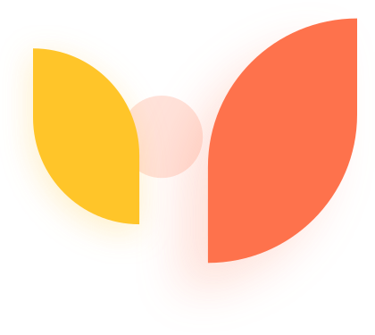
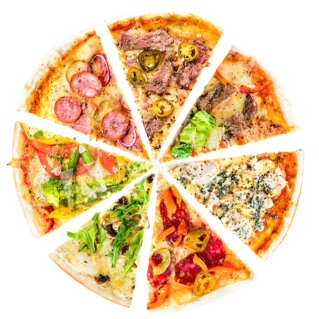

# 🍕 Полная документация, структура и исходный код проекта React Pizza

> **Описание документа**: Данный файл содержит подробное архитектурное описание, полное дерево каталогов и **100% исходный код всех файлов проекта React Pizza** без сокращений и пропусков.

## 📌 Содержание

1. [Стек технологий и архитектура проекта](#1-стек-технологий-и-архитектура-проекта)
2. [Древовидная структура каталогов (Directory Tree)](#2-древовидная-структура-каталогов-directory-tree)
3. [1. Корневые конфигурационные файлы (Root)](#1-корневые-конфигурационные-файлы-root)
4. [2. Корневая папка исходного кода (`src/`)](#2-корневая-папка-исходного-кода-src)
5. [3. Модели данных и интерфейсы (`src/interfaces/`)](#3-модели-данных-и-интерфейсы-srcinterfaces)
6. [4. Вспомогательные хелперы и утилиты (`src/helpers/`)](#4-вспомогательные-хелперы-и-утилиты-srchelpers)
7. [5. Управление состоянием приложения (Redux Toolkit — `src/store/`)](#5-управление-состоянием-приложения-redux-toolkit--srcstore)
8. [6. Каркасы и макеты страниц (`src/layout/`)](#6-каркасы-и-макеты-страниц-srclayout)
9. [7. Переиспользуемые UI-компоненты (`src/components/`)](#7-переиспользуемые-ui-компоненты-srccomponents)
10. [8. Страницы приложения (`src/pages/`)](#8-страницы-приложения-srcpages)
11. [9. Векторные статические ассеты интерфейса (`public/`)](#9-векторные-статические-ассеты-интерфейса-public)
12. [Обзор растровых изображений и ассетов](#12-обзор-растровых-изображений-и-ассетов)

---

## 1. Стек технологий и архитектура проекта

### Ключевой стек:
- **Фреймворк и сборка**: [React 18](https://react.dev/), [TypeScript](https://www.typescriptlang.org/), [Vite](https://vitejs.dev/) с быстрым плагином SWC (`@vitejs/plugin-react-swc`).
- **Управление состоянием (State Management)**: [@reduxjs/toolkit](https://redux-toolkit.js.org/) + `react-redux`.
  - **`userSlice`**: регистрация, авторизация (JWT), загрузка данных профиля пользователя с бэкенда через `createAsyncThunk`, выход из аккаунта.
  - **`cartSlice`**: состояние корзины (добавление позиций, инкремент/декремент, удаление, подсчет суммы товаров).
  - **Persist (Синхронизация с LocalStorage)**: через утилиты `storage.ts` и `store.subscribe` состояние корзины и токен пользователя автоматически сохраняются в браузере и восстанавливаются при перезагрузке.
- **Маршрутизация (Routing)**: [React Router v6](https://reactrouter.com/) с современной объектной конфигурацией (`createBrowserRouter`, `RouterProvider`).
  - Ленивая загрузка (`React.lazy` + `Suspense`) для разделения бандла по страницам.
  - Защищенный роут `RequireAuth` — если пользователь не авторизован (нет токена), доступ к корзине и меню закрыт, происходит редирект на экран авторизации.
  - Асинхронные лоадеры данных с использованием `defer` и компонента `Await`.
- **Стилизация**: CSS Modules (`*.module.css`) для полной инкапсуляции стилей каждого компонента и предотвращения глобальных коллизий.
- **Сетевой слой**: [Axios](https://axios-http.com/) для выполнения REST API запросов к бэкенду с пробросом заголовков `Authorization: Bearer ${jwt}`.

---

## 2. Древовидная структура каталогов (Directory Tree)

Ниже представлена полная схема папок и файлов проекта (за исключением сгенерированной `node_modules`):

```text
react-pizza/
├── .eslintrc.cjs
├── .gitignore
├── README.md
├── index.html
├── package-lock.json
├── package.json
├── public/
│   ├── avatar.png
│   ├── cart-button-icon.svg
│   ├── cart-icon.svg
│   ├── delete-icon.svg
│   ├── exit-icon.svg
│   ├── images/
│   │   └── food/
│   │       ├── food1.jpg
│   │       ├── food2.jpg
│   │       ├── food3.jpg
│   │       ├── food4.jpg
│   │       ├── food5.jpg
│   │       └── food6.jpg
│   ├── logo.svg
│   ├── menu-icon.svg
│   ├── minus-icon.svg
│   ├── pizza.png
│   ├── plus-icon.svg
│   ├── product-demo.png
│   ├── search-icon.svg
│   ├── star-icon.svg
│   └── vite.svg
├── src/
│   ├── assets/
│   │   └── react.svg
│   ├── components/
│   │   ├── Button/
│   │   │   ├── Button.module.css
│   │   │   ├── Button.props.ts
│   │   │   └── Button.tsx
│   │   ├── CartItem/
│   │   │   ├── CartItem.module.css
│   │   │   ├── CartItem.props.ts
│   │   │   └── CartItem.tsx
│   │   ├── Headling/
│   │   │   ├── Headling.module.css
│   │   │   ├── Headling.props.ts
│   │   │   └── Headling.tsx
│   │   ├── Input/
│   │   │   ├── Input.module.css
│   │   │   ├── Input.props.ts
│   │   │   └── Input.tsx
│   │   ├── ProductCard/
│   │   │   ├── ProductCard.module.css
│   │   │   ├── ProductCard.props.ts
│   │   │   └── ProductCard.tsx
│   │   └── Search/
│   │       ├── Search.module.css
│   │       ├── Search.props.ts
│   │       └── Search.tsx
│   ├── helpers/
│   │   ├── API.ts
│   │   └── RequireAuth.tsx
│   ├── index.css
│   ├── interfaces/
│   │   ├── auth.interface.ts
│   │   ├── product.interface.ts
│   │   └── user.interface.ts
│   ├── layout/
│   │   ├── Auth/
│   │   │   ├── AuthLayout.module.css
│   │   │   └── AuthLayout.tsx
│   │   └── Menu/
│   │       ├── Layout.module.css
│   │       └── Layout.tsx
│   ├── main.tsx
│   ├── pages/
│   │   ├── Cart/
│   │   │   ├── Cart.module.css
│   │   │   └── Cart.tsx
│   │   ├── Error/
│   │   │   └── Error.tsx
│   │   ├── Login/
│   │   │   ├── Login.module.css
│   │   │   └── Login.tsx
│   │   ├── Menu/
│   │   │   ├── Menu.module.css
│   │   │   ├── Menu.tsx
│   │   │   └── MenuList/
│   │   │       ├── MenuList.module.css
│   │   │       ├── MenuList.props.ts
│   │   │       └── MenuList.tsx
│   │   ├── Product/
│   │   │   └── Product.tsx
│   │   ├── Register/
│   │   │   └── Register.tsx
│   │   └── Success/
│   │       ├── Success.module.css
│   │       └── Success.tsx
│   ├── store/
│   │   ├── cart.slice.ts
│   │   ├── storage.ts
│   │   ├── store.ts
│   │   └── user.slice.ts
│   └── vite-env.d.ts
├── tsconfig.json
├── tsconfig.node.json
└── vite.config.ts
```


---

## 1. Корневые конфигурационные файлы (Root)

> Конфигурация сборщика Vite, компилятора TypeScript, линтера ESLint и зависимостей npm.


### 📄 `package.json`

**Описание**: Манифест проекта с зависимостями (React 18, Redux Toolkit, React Router v6, Axios, Classnames) и скриптами сборки.


```json
{
  "name": "pizza-app",
  "private": true,
  "version": "0.0.0",
  "type": "module",
  "scripts": {
    "dev": "vite",
    "build": "tsc && vite build",
    "lint": "eslint . --ext ts,tsx --report-unused-disable-directives --max-warnings 0",
    "preview": "vite preview"
  },
  "dependencies": {
    "@reduxjs/toolkit": "^1.9.5",
    "axios": "^1.4.0",
    "classnames": "^2.3.2",
    "react": "^18.2.0",
    "react-dom": "^18.2.0",
    "react-redux": "^8.1.2",
    "react-router-dom": "^6.15.0"
  },
  "devDependencies": {
    "@types/react": "^18.2.15",
    "@types/react-dom": "^18.2.7",
    "@typescript-eslint/eslint-plugin": "^6.0.0",
    "@typescript-eslint/parser": "^6.0.0",
    "@vitejs/plugin-react-swc": "^3.3.2",
    "eslint": "^8.45.0",
    "eslint-plugin-react-hooks": "^4.6.0",
    "eslint-plugin-react-refresh": "^0.4.3",
    "typescript": "^5.0.2",
    "vite": "^4.4.5"
  }
}

```


### 📄 `vite.config.ts`

**Описание**: Конфигурация сборщика Vite с поддержкой SWC (@vitejs/plugin-react-swc) для молниеносного Fast Refresh.


```typescript
import { defineConfig } from 'vite'
import react from '@vitejs/plugin-react-swc'

// https://vitejs.dev/config/
export default defineConfig({
  base: '/',
  plugins: [react()],
  server: {
    port: 3005,
    strictPort: true
  }
})

```


### 📄 `tsconfig.json`

**Описание**: Основной файл настроек TypeScript (target ES2020, модуль ESNext, react-jsx, строгий режим strict: true).


```json
{
  "compilerOptions": {
    "target": "ES2020",
    "useDefineForClassFields": true,
    "lib": ["ES2020", "DOM", "DOM.Iterable"],
    "module": "ESNext",
    "skipLibCheck": true,

    /* Bundler mode */
    "moduleResolution": "bundler",
    "allowImportingTsExtensions": true,
    "resolveJsonModule": true,
    "isolatedModules": true,
    "noEmit": true,
    "jsx": "react-jsx",

    /* Linting */
    "strict": true,
    "noUnusedLocals": true,
    "noUnusedParameters": true,
    "noFallthroughCasesInSwitch": true
  },
  "include": ["src"],
  "references": [{ "path": "./tsconfig.node.json" }]
}

```


### 📄 `tsconfig.node.json`

**Описание**: Настройки TypeScript для файлов окружения Node.js (vite.config.ts).


```json
{
  "compilerOptions": {
    "composite": true,
    "skipLibCheck": true,
    "module": "ESNext",
    "moduleResolution": "bundler",
    "allowSyntheticDefaultImports": true
  },
  "include": ["vite.config.ts"]
}

```


### 📄 `index.html`

**Описание**: Основной HTML-документ SPA приложения, подключение шрифтов Google Fonts (Open Sans), контейнер <div id="root">.


```html
<!DOCTYPE html>
<html lang="en">
  <head>
    <meta charset="UTF-8" />
    <link rel="icon" type="image/svg+xml" href="/vite.svg" />
    <meta name="viewport" content="width=device-width, initial-scale=1.0" />
    <title>Pizza App</title>
    <link rel="preconnect" href="https://fonts.googleapis.com" />
    <link rel="preconnect" href="https://fonts.gstatic.com" crossorigin />
    <link
      href="https://fonts.googleapis.com/css2?family=Open+Sans:wght@300;400;600&family=Source+Sans+3:wght@300;400;600&display=swap"
      rel="stylesheet"
    />
  </head>
  <body>
    <div id="root"></div>
    <script type="module" src="/src/main.tsx"></script>
  </body>
</html>

```


### 📄 `.eslintrc.cjs`

**Описание**: Конфигурация ESLint с правилами для React Hooks и TypeScript.


```javascript
module.exports = {
  root: true,
  env: { browser: true, es2020: true },
  extends: [
    'eslint:recommended',
    'plugin:@typescript-eslint/recommended',
    'plugin:react-hooks/recommended',
  ],
  ignorePatterns: ['dist', '.eslintrc.cjs'],
  parser: '@typescript-eslint/parser',
  plugins: ['react-refresh'],
  rules: {
    'react-refresh/only-export-components': [
      'warn',
      { allowConstantExport: true },
    ],
	'semi': ['error', 'always', { 'omitLastInOneLineBlock': false}],
	'comma-dangle': ['error', 'never'],
	quotes: ['error', 'single'],
	'react/prop-types': [0],
	'indent': ['error', 'tab']
  },
}

```


### 📄 `.gitignore`

**Описание**: Список исключений для системы контроля версий Git (node_modules, dist, временные файлы).


```text
# Logs
logs
*.log
npm-debug.log*
yarn-debug.log*
yarn-error.log*
pnpm-debug.log*
lerna-debug.log*

node_modules
dist
dist-ssr
*.local

# Editor directories and files
.vscode/*
!.vscode/extensions.json
.idea
.DS_Store
*.suo
*.ntvs*
*.njsproj
*.sln
*.sw?

```


### 📄 `README.md`

**Описание**: Базовое руководство по шаблону React + TypeScript + Vite.


```markdown
# React + TypeScript + Vite

This template provides a minimal setup to get React working in Vite with HMR and some ESLint rules.

Currently, two official plugins are available:

- [@vitejs/plugin-react](https://github.com/vitejs/vite-plugin-react/blob/main/packages/plugin-react/README.md) uses [Babel](https://babeljs.io/) for Fast Refresh
- [@vitejs/plugin-react-swc](https://github.com/vitejs/vite-plugin-react-swc) uses [SWC](https://swc.rs/) for Fast Refresh

## Expanding the ESLint configuration

If you are developing a production application, we recommend updating the configuration to enable type aware lint rules:

- Configure the top-level `parserOptions` property like this:

```js
   parserOptions: {
    ecmaVersion: 'latest',
    sourceType: 'module',
    project: ['./tsconfig.json', './tsconfig.node.json'],
    tsconfigRootDir: __dirname,
   },
```

- Replace `plugin:@typescript-eslint/recommended` to `plugin:@typescript-eslint/recommended-type-checked` or `plugin:@typescript-eslint/strict-type-checked`
- Optionally add `plugin:@typescript-eslint/stylistic-type-checked`
- Install [eslint-plugin-react](https://github.com/jsx-eslint/eslint-plugin-react) and add `plugin:react/recommended` & `plugin:react/jsx-runtime` to the `extends` list

```


---

## 2. Корневая папка исходного кода (`src/`)

> Точка входа приложения, глобальные стили и глобальные типы окружения.


### 📄 `src/main.tsx`

**Описание**: Главная точка входа React: конфигурация React Router через createBrowserRouter, ленивая загрузка (lazy + Suspense), защищенный RequireAuth маршрут, провайдер Redux Store.


```tsx
import React, { Suspense, lazy } from 'react';
import ReactDOM from 'react-dom/client';
import './index.css';
import { RouterProvider, createBrowserRouter, defer } from 'react-router-dom';
import { Cart } from './pages/Cart/Cart.tsx';
import { Error as ErropPage } from './pages/Error/Error.tsx';
import { Layout } from './layout/Menu/Layout.tsx';
import { Product } from './pages/Product/Product.tsx';
import axios from 'axios';
import { PREFIX } from './helpers/API.ts';
import { AuthLayout } from './layout/Auth/AuthLayout.tsx';
import { Login } from './pages/Login/Login.tsx';
import { Register } from './pages/Register/Register.tsx';
import { RequireAuth } from './helpers/RequireAuth.tsx';
import { Provider } from 'react-redux';
import { store } from './store/store.ts';
import { Success } from './pages/Success/Success.tsx';

const Menu = lazy(() => import('./pages/Menu/Menu'));

const router = createBrowserRouter([
	{
		path: '/',
		element: <RequireAuth><Layout /></RequireAuth>,
		children: [
			{
				path: '/',
				element: <Suspense fallback={<>Загрузка...</>}><Menu /></Suspense>
			},
			{
				path: '/success',
				element: <Success />
			},
			{
				path: '/cart',
				element: <Cart />
			},
			{
				path: '/product/:id',
				element: <Product />,
				errorElement: <>Ошибка</>,
				loader: async ({ params }) => {
					return defer({
						data: new Promise((resolve, reject) => {
							setTimeout(() => {
								axios.get(`${PREFIX}/products/${params.id}`).then(data => resolve(data)).catch(e => reject(e));
							}, 2000);
						})
					});
				}
			}
		]
	},
	{
		path: '/auth',
		element: <AuthLayout />,
		children: [
			{
				path: 'login',
				element: <Login />
			}, {
				path: 'register',
				element: <Register />
			}
		]
	},
	{
		path: '*',
		element: <ErropPage />
	}
]);

ReactDOM.createRoot(document.getElementById('root')!).render(
	<React.StrictMode>
		<Provider store={store}>
			<RouterProvider router={router} />
		</Provider>
	</React.StrictMode>
);

```


### 📄 `src/index.css`

**Описание**: Глобальные CSS-стили: сброс базовых отступов, CSS-переменные цветов (:root --primary-color, --text-color, --background), шрифты Open Sans.


```css
:root {
  --font: 'Open Sans', sans-serif;
  --primary-color: #FE724C;
  --primary-hover-color: #df6442;
  --text-color: #000000;
  --text-secondary-color: #5B5B5E;
  --white-color: #FFFFFF;
  --separator-color: #D4D6E0;
}

body {
	font-family: 'Open Sans', sans-serif;
	margin: 0;
}
```


### 📄 `src/vite-env.d.ts`

**Описание**: Декларация типов для клиентского окружения Vite (импорт svg, png, переменных vite/client).


```typescript
/// <reference types="vite/client" />

```


---

## 3. Модели данных и интерфейсы (`src/interfaces/`)

> Типизация ключевых сущностей предметной области пиццерии: авторизация, товар и пользователь.


### 📄 `src/interfaces/auth.interface.ts`

**Описание**: Интерфейс ответа сервера авторизации LoginResponse (содержит JWT access_token).


```typescript
export interface LoginResponse {
	access_token: string;
}
```


### 📄 `src/interfaces/product.interface.ts`

**Описание**: Интерфейс Product: id, name, price, rating, image, ingredients.


```typescript
export interface Product {
	id: number
	name: string
	price: number
	ingredients: string[]
	image: string
	rating: number
}

```


### 📄 `src/interfaces/user.interface.ts`

**Описание**: Интерфейс профиля пользователя Profile: id, email, name, phone, address.


```typescript
export interface Profile {
	id: number;
	email: string;
	address: string;
	name: string;
	phone: string;
}
```


---

## 4. Вспомогательные хелперы и утилиты (`src/helpers/`)

> Константы сетевого взаимодействия и компонент высшего порядка для защиты роутов.


### 📄 `src/helpers/API.ts`

**Описание**: Константа PREFIX: базовый адрес REST API бэкенда (https://purpleschool.ru/pizza-api-demo).


```typescript
export const PREFIX = 'https://purpleschool.ru/pizza-api-demo';
```


### 📄 `src/helpers/RequireAuth.tsx`

**Описание**: Компонент защиты маршрутов RequireAuth: проверяет наличие JWT токена в стейте Redux; при отсутствии перенаправляет на /auth/login через Navigate.


```tsx
import { ReactNode } from 'react';
import { useSelector } from 'react-redux';
import { Navigate } from 'react-router-dom';
import { RootState } from '../store/store';

export const RequireAuth = ({ children }: { children: ReactNode }) => {
	const jwt = useSelector((s: RootState) => s.user.jwt);
	if (!jwt) {
		return <Navigate to="/auth/login" replace />;
	}
	return children;
};
```


---

## 5. Управление состоянием приложения (Redux Toolkit — `src/store/`)

> Глобальный стейт-менеджер: хранилище, локальное сохранение корзины и слайсы пользователя и корзины.


### 📄 `src/store/store.ts`

**Описание**: Конфигурация Redux Store через configureStore, регистрация редюсеров userSlice и cartSlice, подписка store.subscribe для сохранения корзины в localStorage.


```typescript
import { configureStore } from '@reduxjs/toolkit';
import userSlice, { JWT_PERSISTENT_STATE } from './user.slice';
import { saveState } from './storage';
import cartSlice, { CART_PERSISTENT_STATE } from './cart.slice';

export const store = configureStore({
	reducer: {
		user: userSlice,
		cart: cartSlice
	}
});

store.subscribe(() => {
	saveState({ jwt: store.getState().user.jwt }, JWT_PERSISTENT_STATE);
	saveState(store.getState().cart, CART_PERSISTENT_STATE);
});

export type RootState = ReturnType<typeof store.getState>;
export type AppDispath = typeof store.dispatch;
```


### 📄 `src/store/storage.ts`

**Описание**: Утилиты loadState и saveState для безопасной работы с JSON в localStorage (с обработкой исключений).


```typescript
export function loadState<T>(key: string): T | undefined {
	try {
		const jsonState = localStorage.getItem(key);
		if (!jsonState) {
			return undefined;
		}
		return JSON.parse(jsonState);
	} catch (e) {
		console.error(e);
		return undefined;
	}
}

export function saveState<T>(state: T, key: string) {
	const stringState = JSON.stringify(state);
	localStorage.setItem(key, stringState);
}
```


### 📄 `src/store/cart.slice.ts`

**Описание**: Слайс корзины cartSlice: экшены add (добавление/инкремент), remove (декремент), delete (полное удаление позиции), clean (очистка корзины), типы CartItem и CartState.


```typescript
import { PayloadAction, createSlice } from '@reduxjs/toolkit';
import { loadState } from './storage';

export const CART_PERSISTENT_STATE = 'cartData';

export interface CartItem {
	id: number;
	count: number;
}

export interface CartState {
	items: CartItem[];
}

const initialState: CartState = loadState<CartState>(CART_PERSISTENT_STATE) ?? {
	items: []
};

export const cartSlice = createSlice({
	name: 'cart',
	initialState,
	reducers: {
		clean: (state) => {
			state.items = [];
		},
		delete: (state, action: PayloadAction<number>) => {
			state.items = state.items.filter(i => i.id !== action.payload);
		},
		remove: (state, action: PayloadAction<number>) => {
			const existed = state.items.find(i => i.id === action.payload);
			if (!existed) {
				return;
			}
			if (existed.count === 1) {
				state.items = state.items.filter(i => i.id !== action.payload);
			} else {
				state.items.map(i => {
					if (i.id === action.payload) {
						i.count -= 1;
					}
					return i;
				});
				return;
			}

		},
		add: (state, action: PayloadAction<number>) => {
			const existed = state.items.find(i => i.id === action.payload);
			if (!existed) {
				state.items.push({ id: action.payload, count: 1 });
				return;
			}
			state.items.map(i => {
				if (i.id === action.payload) {
					i.count += 1;
				}
				return i;
			});
		}
	}
});

export default cartSlice.reducer;
export const cartActions = cartSlice.actions;
```


### 📄 `src/store/user.slice.ts`

**Описание**: Слайс пользователя userSlice: асинхронные санк-экшены (login, register, getProfile), сохранение JWT токена, обработка ошибок авторизации (loginErrorMessage, registerErrorMessage), экшен logout.


```typescript
import { createAsyncThunk, createSlice } from '@reduxjs/toolkit';
import { loadState } from './storage';
import { LoginResponse } from '../interfaces/auth.interface';
import axios, { AxiosError } from 'axios';
import { PREFIX } from '../helpers/API';
import { Profile } from '../interfaces/user.interface';
import { RootState } from './store';

export const JWT_PERSISTENT_STATE = 'userData';

export interface UserPersistentState {
	jwt: string | null;
}

export interface UserState {
	jwt: string | null;
	loginErrorMessage?: string;
	registerErrorMessage?: string;
	profile?: Profile;
}

const initialState: UserState = {
	jwt: loadState<UserPersistentState>(JWT_PERSISTENT_STATE)?.jwt ?? null
};

export const login = createAsyncThunk('user/login',
	async (params: { email: string, password: string }) => {
		try {
			const { data } = await axios.post<LoginResponse>(`${PREFIX}/auth/login`, {
				email: params.email,
				password: params.password
			});
			return data;
		} catch (e) {
			if (e instanceof AxiosError) {
				throw new Error(e.response?.data.message);
			}
		}
	}
);

export const register = createAsyncThunk('user/register',
	async (params: { email: string, password: string, name: string }) => {
		try {
			const { data } = await axios.post<LoginResponse>(`${PREFIX}/auth/register`, {
				email: params.email,
				password: params.password,
				name: params.name
			});
			return data;
		} catch (e) {
			if (e instanceof AxiosError) {
				throw new Error(e.response?.data.message);
			}
		}
	}
);

export const getProfile = createAsyncThunk<Profile, void, { state: RootState }>('user/getProfile',
	async (_, thunkApi) => {
		const jwt = thunkApi.getState().user.jwt;
		const { data } = await axios.get<Profile>(`${PREFIX}/user/profile`, {
			headers: {
				Authorization: `Bearer ${jwt}`
			}
		});
		return data;
	}
);

export const userSlice = createSlice({
	name: 'user',
	initialState,
	reducers: {
		logout: (state) => {
			state.jwt = null;
		},
		clearLoginError: (state) => {
			state.loginErrorMessage = undefined;
		},
		clearRegisterError: (state) => {
			state.registerErrorMessage = undefined;
		}
	},
	extraReducers: (builder) => {
		builder.addCase(login.fulfilled, (state, action) => {
			if (!action.payload) {
				return;
			}
			state.jwt = action.payload.access_token;
		});
		builder.addCase(login.rejected, (state, action) => {
			state.loginErrorMessage = action.error.message;
		});

		builder.addCase(getProfile.fulfilled, (state, action) => {
			state.profile = action.payload;
		});

		builder.addCase(register.fulfilled, (state, action) => {
			if (!action.payload) {
				return;
			}
			state.jwt = action.payload.access_token;
		});
		builder.addCase(register.rejected, (state, action) => {
			state.registerErrorMessage = action.error.message;
		});
	}
});

export default userSlice.reducer;
export const userActions = userSlice.actions;
```


---

## 6. Каркасы и макеты страниц (`src/layout/`)

> Компоненты Layout: боковая панель навигации приложения и двухколоночный макет для авторизации.


### 📄 `src/layout/Menu/Layout.tsx`

**Описание**: Главный лейаут приложения: боковая панель (Sidebar), отображение аватара и имени пользователя, навигационные ссылки NavLink в 'Меню' и 'Корзину' (с бейджем счетчика блюд), кнопка логаута, Outlet для контента.


```tsx
import { NavLink, Outlet, useNavigate } from 'react-router-dom';
import styles from './Layout.module.css';
import Button from '../../components/Button/Button';
import cn from 'classnames';
import { useDispatch, useSelector } from 'react-redux';
import { AppDispath, RootState } from '../../store/store';
import { getProfile, userActions } from '../../store/user.slice';
import { useEffect } from 'react';

export function Layout() {
	const navigate = useNavigate();
	const dispatch = useDispatch<AppDispath>();
	const profile = useSelector((s: RootState) => s.user.profile);
	const items = useSelector((s: RootState) => s.cart.items);

	useEffect(() => {
		dispatch(getProfile());
	}, [dispatch]);

	const logout = () => {
		dispatch(userActions.logout());
		navigate('/auth/login');
	};

	return <div className={styles['layout']}>
		<div className={styles['sidebar']}>
			<div className={styles['user']}>
				
				<div className={styles['name']}>{profile?.name}</div>
				<div className={styles['email']}>{profile?.email}</div>
			</div>
			<div className={styles['menu']}>
				<NavLink to='/' className={({ isActive }) => cn(styles['link'], {
					[styles.active]: isActive
				})}>
					
					Меню</NavLink>
				<NavLink to='/cart' className={({ isActive }) => cn(styles['link'], {
					[styles.active]: isActive
				})}>
					Корзина <span className={styles['cart-count']}>{items.reduce((acc, item) => acc += item.count, 0)}</span></NavLink>

			</div>
			<Button className={styles['exit']} onClick={logout}>
				
				Выход
			</Button>
		</div>
		<div className={styles['content']}>
			<Outlet />
		</div>
	</div>;
}
```


### 📄 `src/layout/Menu/Layout.module.css`

**Описание**: Стили боковой панели, адаптивная сетка (grid-template-columns: 280px 1fr), активные ссылки меню, бейдж количества товаров.


```css
.layout {
	display: flex;
	min-height: 100vh;
}

.sidebar {
	padding: 30px;
	border-right: 1px solid var(--separator-color);
	display: flex;
	flex-direction: column;
}

.exit {
	margin-top: auto;
	display: flex;
	align-items: center;
	justify-content: center;
	gap: 9px;
}

.menu {
	display: flex;
	flex-direction: column;
	gap: 35px;
}

.link {
	display: flex;
	align-items: center;
	gap: 14px;
	text-decoration: none;
	color: var(--text-color);
}

.link:hover {
	color: var(--primary-color);
}

.active {
	color: var(--primary-color);
}

.user {
	margin-bottom: 46px;
}

.avatar {
	margin-bottom: 20px;
	filter: drop-shadow(0px 8px 40px rgba(255, 197, 41, 0.25));
}

.name {
	font-size: 20px;
	font-style: normal;
	font-weight: 700;
	line-height: normal;
	color: var(--text-color);
}

.email {
	font-family: Open Sans;
	font-size: 14px;
	font-style: normal;
	font-weight: 400;
	line-height: normal;
	color: #9EA1B1;
}

.content {
	padding: 40px 60px;
	width: 100%;
}

.cart-count {
	background: var(--primary-color);
	border-radius: 50%;
	width: 20px;
	height: 20px;
	display: flex;
	align-items: center;
	justify-content: center;
	font-size: 12px;
	color: var(--white-color);
}
```


### 📄 `src/layout/Auth/AuthLayout.tsx`

**Описание**: Лейаут для страниц входа и регистрации: двухколоночная верстка с брендингом пиццерии слева и контейнером формы справа.


```tsx
import { Outlet } from 'react-router-dom';
import styles from './AuthLayout.module.css';

export function AuthLayout() {
	return <div className={styles['layout']}>
		<div className={styles['logo']}>
			
		</div>
		<div className={styles['content']}>
			<Outlet />
		</div>
	</div>;
}
```


### 📄 `src/layout/Auth/AuthLayout.module.css`

**Описание**: Стили лейаута авторизации с гибкой сеткой и центрированием формы.


```css
.layout {
	display: flex;
	min-height: 100vh;
}

.logo {
	flex: 1;
	display: flex;
	align-items: center;
	justify-content: center;
}

.content {
	border-left: 1px solid var(--separator-color);
	flex: 1;
	display: flex;
	align-items: center;
	justify-content: center;
}
```


---

## 7. Переиспользуемые UI-компоненты (`src/components/`)

> Библиотека UI-компонентов: кнопки, инпуты, заголовки, поле поиска, карточка товара и строка корзины.


### 📄 `src/components/Button/Button.props.ts`

**Описание**: Интерфейс ButtonProps (наследует ButtonHTMLAttributes<HTMLButtonElement>, добавляет размерный признак appearence: 'big' | 'small').


```typescript
import { ButtonHTMLAttributes, ReactNode } from 'react';

export interface ButtonProps extends ButtonHTMLAttributes<HTMLButtonElement> {
	children: ReactNode;
	appearence?: 'big' | 'small';
}
```


### 📄 `src/components/Button/Button.tsx`

**Описание**: Универсальный компонент кнопки с поддержкой вариантов размеров ('big'/'small') через classnames.


```tsx
import styles from './Button.module.css';
import { ButtonProps } from './Button.props';
import cn from 'classnames';

function Button({ children, className, appearence = 'small', ...props }: ButtonProps) {
	return (
		<button className={cn(styles['button'], styles['accent'], className, {
			[styles['small']]: appearence === 'small',
			[styles['big']]: appearence === 'big'
		})} {...props}>{children}</button>
	);
}

export default Button;
```


### 📄 `src/components/Button/Button.module.css`

**Описание**: Стили кнопки: градиенты, оранжевый акцентный фон, hover/active состояния, размеры отступов и шрифтов.


```css
.button {
	font-family: inherit;
	cursor: pointer;
	transition: background 0.25s;
	border: none;
	color: var(--white-color);
	border-radius: 29px;
	font-style: normal;
	font-weight: 400;
}

.small {
	font-size: 16px;
	padding: 10px 25px;
}

.big {
	font-size: 15px;
	text-transform: uppercase;
	padding: 20px 60px;
	box-shadow: 0px 10px 40px 0px rgba(122, 129, 190, 0.16);
}

.accent {
	background: var(--primary-color);
}

.accent:hover {
	background: var(--primary-hover-color);
}
```


### 📄 `src/components/Input/Input.props.ts`

**Описание**: Интерфейс InputProps (наследует InputHTMLAttributes<HTMLInputElement>, флаг isValid для валидации).


```typescript
import { InputHTMLAttributes } from 'react';

export interface InputProps extends InputHTMLAttributes<HTMLInputElement> {
	isValid?: boolean;
}
```


### 📄 `src/components/Input/Input.tsx`

**Описание**: Кастомный инпут с поддержкой forwardRef и визуальным отображением состояния ошибки ввода.


```tsx
import { forwardRef } from 'react';
import styles from './Input.module.css';
import cn from 'classnames';
import { InputProps } from './Input.props';

const Input = forwardRef<HTMLInputElement, InputProps>(function Input({ isValid = true, className, ...props }, ref) {
	return (
		<input ref={ref} className={cn(styles['input'], className, {
			[styles['invalid']]: isValid
		})} {...props} />
	);
});

export default Input;
```


### 📄 `src/components/Input/Input.module.css`

**Описание**: Стили поля ввода, плейсхолдеры, фокус и рамка ошибки border: 1px solid var(--error-color).


```css
.input {
	font-size: 17px;
	font-style: normal;
	font-weight: 400;
	color: var(--text-color);
	border: 1px solid #EEE;
	box-shadow: 15px 20px 45px 0px rgba(233, 233, 233, 0.25);
	border-radius: 10px;
	padding: 20px;
}
```


### 📄 `src/components/Headling/Headling.props.ts`

**Описание**: Интерфейс HeadlingProps для главного заголовка страницы.


```typescript
import { HTMLAttributes, ReactNode } from 'react';

export interface HeadlingProps extends HTMLAttributes<HTMLHeadingElement> {
	children: ReactNode;
}
```


### 📄 `src/components/Headling/Headling.tsx`

**Описание**: Презентационный заголовок h1 с единым стилем приложения.


```tsx
import styles from './Headling.module.css';
import cn from 'classnames';
import { HeadlingProps } from './Headling.props';

function Headling({ children, className, ...props }: HeadlingProps) {
	return (
		<h1 className={cn(className, styles['h1'])} {...props}>{children}</h1>
	);
}

export default Headling;
```


### 📄 `src/components/Headling/Headling.module.css`

**Описание**: Стили типографики заголовка.


```css
.h1 {
	color: var(--text-color);
	font-size: 36.413px;
	font-style: normal;
	font-weight: 600;
	line-height: 120%;
	margin: 0;
}
```


### 📄 `src/components/Search/Search.props.ts`

**Описание**: Интерфейс SearchProps для поля поиска.


```typescript
import { InputHTMLAttributes } from 'react';

export interface SearchProps extends InputHTMLAttributes<HTMLInputElement> {
	isValid?: boolean;
}
```


### 📄 `src/components/Search/Search.tsx`

**Описание**: Компонент поиска блюд со встроенной иконкой лупы и forwardRef.


```tsx
import { forwardRef } from 'react';
import styles from './Search.module.css';
import cn from 'classnames';
import { SearchProps } from './Search.props';

const Search = forwardRef<HTMLInputElement, SearchProps>(function Input({ isValid = true, className, ...props }, ref) {
	return (
		<div className={styles['input-wrapper']}>
			<input ref={ref} className={cn(styles['input'], className, {
				[styles['invalid']]: isValid
			})} {...props} />
			
		</div>
	);
});

export default Search;
```


### 📄 `src/components/Search/Search.module.css`

**Описание**: Стили поля поиска с левым отступом под векторную иконку.


```css
.input {
	font-size: 14px;
	font-style: normal;
	font-weight: 400;
	color: var(--text-color);
	background-color: #FCFCFD;
	border: 1px solid #EFEFEF;
	box-shadow: 15px 20px 45px 0px rgba(233, 233, 233, 0.25);
	border-radius: 10px;
	padding: 16px 30px 16px 44px;
	min-width: 200px;
}

.input-wrapper {
	position: relative;
}

.icon {
	position: absolute;
	left: 17px;
	top: 17px;
}
```


### 📄 `src/components/ProductCard/ProductCard.props.ts`

**Описание**: Интерфейс ProductCardProps (данные пиццы/блюда: id, name, description, image, price, rating).


```typescript
export interface ProductCardProps {
	id: number;
	name: string;
	description: string;
	image: string;
	price: number;
	rating: number;
}
```


### 📄 `src/components/ProductCard/ProductCard.tsx`

**Описание**: Карточка товара с фотографией блюда, бейджем цены, плашкой рейтинга со звездой, названием, описанием ингредиентов и кнопкой добавления в корзину.


```tsx
import { Link } from 'react-router-dom';
import styles from './ProductCard.module.css';
import { ProductCardProps } from './ProductCard.props';
import { MouseEvent } from 'react';
import { useDispatch } from 'react-redux';
import { AppDispath } from '../../store/store';
import { cartActions } from '../../store/cart.slice';

function ProductCard(props: ProductCardProps) {
	const dispatch = useDispatch<AppDispath>();

	const add = (e: MouseEvent) => {
		e.preventDefault();
		dispatch(cartActions.add(props.id));
	};

	const imageUrl = (props.id >= 1 && props.id <= 6) ? `/images/food/food${props.id}.jpg` : (props.image || '/images/food/food1.jpg');

	return (
		<Link to={`/product/${props.id}`} className={styles['link']}>
			<div className={styles['card']}>
				<div className={styles['head']} style={{ backgroundImage: `url('${imageUrl}')` }}>
					<div className={styles['price']}>
						{props.price}&nbsp;
						<span className={styles['currency']}>₽</span>
					</div>
					<button className={styles['add-to-cart']} onClick={add}>
						
					</button>
					<div className={styles['rating']}>
						{props.rating}&nbsp;
						
					</div>
				</div>
				<div className={styles['footer']}>
					<div className={styles['title']}>{props.name}</div>
					<div className={styles['description']}>{props.description}</div>
				</div>
			</div>
		</Link>
	);
}

export default ProductCard;

```


### 📄 `src/components/ProductCard/ProductCard.module.css`

**Описание**: Стили карточки товара: карточная тень, плавающий бейдж цены, плашка рейтинга, кнопка добавления поверх картинки.


```css
.head {
	position: relative;
	min-height: 165px;
	border-radius: 19px;
}

.card {
	background: var(--white-color);
	border-radius: 19px;
	box-shadow: 18.21428680419922px 18.21428680419922px 36.42857360839844px 0px rgba(211, 209, 216, 0.25);
	width: 320px;
}

.footer {
	padding: 12px;
}

.title {
	color: var(--text-color);
	font-size: 18.214px;
	font-style: normal;
	font-weight: 600;
	line-height: normal;
}

.description {
	color: var(--text-secondary-color);
	font-size: 14.571px;
	font-style: normal;
	font-weight: 400;
	line-height: normal;
}

.link {
	text-decoration: none;
}

.price {
	position: absolute;
	top: 15px;
	left: 15px;
	background: var(--white-color);
	padding: 3px 10px;
	border-radius: 20px;
	color: #111719;
	font-size: 20px;
	font-style: normal;
	font-weight: 400;
	line-height: normal;
}

.currency {
	color: var(--primary-color);
}

.rating {
	position: absolute;
	bottom: -12px;
	left: 15px;
	background: var(--white-color);
	padding: 3px 8px;
	border-radius: 20px;
	color: #111719;
	font-size: 12px;
	font-style: normal;
	font-weight: 400;
	line-height: normal;
	box-shadow: 0px 6.0714287757873535px 24.285715103149414px 0px rgba(254, 114, 76, 0.20);
}

.add-to-cart {
	position: absolute;
	top: 15px;
	right: 15px;
	background: var(--primary-color);
	border-radius: 50%;
	width: 34px;
	height: 34px;
	border: none;
	cursor: pointer;
}

.add-to-cart:hover {
	background: var(--primary-hover-color);
}
```


### 📄 `src/components/CartItem/CartItem.props.ts`

**Описание**: Интерфейс CartItemProps для отображения позиции в корзине.


```typescript
export interface CartItemProps {
	id: number;
	name: string;
	image: string;
	price: number;
	count: number;
}
```


### 📄 `src/components/CartItem/CartItem.tsx`

**Описание**: Интерактивная строка корзины: кнопки изменения количества (+ / -), кнопка удаления (крестик), превью блюда и пересчет суммы.


```tsx
import styles from './CartItem.module.css';
import { useDispatch } from 'react-redux';
import { AppDispath } from '../../store/store';
import { cartActions } from '../../store/cart.slice';
import { CartItemProps } from './CartItem.props';

function CartItem(props: CartItemProps) {
	const dispatch = useDispatch<AppDispath>();

	const increase = () => {
		dispatch(cartActions.add(props.id));
	};

	const descrease = () => {
		dispatch(cartActions.remove(props.id));
	};

	const remove = () => {
		dispatch(cartActions.delete(props.id));
	};

	const imageUrl = (props.id >= 1 && props.id <= 6) ? `/images/food/food${props.id}.jpg` : (props.image || '/images/food/food1.jpg');

	return (
		<div className={styles['item']}>
			<div className={styles['image']} style={{ backgroundImage: `url('${imageUrl}')` }}></div>
			<div className={styles['description']}>
				<div className={styles['name']}>{props.name}</div>
				<div className={styles['price']}>{props.price}&nbsp;₽</div>
			</div>
			<div className={styles['actions']}>
				<button className={styles['minus']} onClick={descrease}>
					
				</button>
				<div className={styles['number']}>{props.count}</div>
				<button className={styles['plus']} onClick={increase}>
					
				</button>
				<button className={styles['remove']} onClick={remove}>
					
				</button>
			</div>
		</div>
	);
}

export default CartItem;

```


### 📄 `src/components/CartItem/CartItem.module.css`

**Описание**: Стили строки корзины: круглая кнопка удаления, кнопки счетчика количества товаров, форматирование цены.


```css
.item {
	display: flex;
	gap: 20px;
	max-width: 512px;
	margin-bottom: 27px;
}

.image {
	width: 82px;
	height: 82px;
	background-size: cover;
	filter: drop-shadow(0px 8px 25px rgba(224, 219, 196, 0.90));
	border-radius: 20px;
}

.actions {
	margin-left: auto;
	display: flex;
	gap: 10px;
	align-items: center;
	align-self: flex-start;
}

.description {
	display: flex;
	flex-direction: column;
	gap: 10px;
}

.name {
	color: var(--text-color);
	font-size: 18px;
	font-style: normal;
	font-weight: 600;
	line-height: normal;
}

.price {
	color: var(--primary-color);
	font-size: 16px;
	font-style: normal;
	font-weight: 600;
	line-height: normal;
}

.minus {
	display: flex;
	align-items: center;
	justify-content: center;
	background: none;
	border: 1px solid var(--primary-color);
	border-radius: 50%;
	width: 29px;
	height: 29px;
}

.plus {
	display: flex;
	align-items: center;
	justify-content: center;
	background: var(--primary-color);
	border: 1px solid var(--primary-color);
	border-radius: 50%;
	width: 29px;
	height: 29px;
}

.remove {
	display: flex;
	align-items: center;
	justify-content: center;
	background: none;
	border: none;
	width: 29px;
	height: 29px;
}

.number {
	color: var(--text-color);
	font-size: 16px;
	font-style: normal;
	font-weight: 600;
	line-height: normal;
}
```


---

## 8. Страницы приложения (`src/pages/`)

> Представления и экраны приложения: меню, корзина, карточка товара, логин, регистрация, страница успеха и 404.


### 📄 `src/pages/Menu/Menu.tsx`

**Описание**: Экран меню: загрузка списка товаров с бэкенда через Axios, локальное состояние фильтрации по поисковой строке, лоадер при ожидании ответа, обработка сетевых ошибок.


```tsx
import { ChangeEvent, useEffect, useState } from 'react';
import Headling from '../../components/Headling/Headling';
import Search from '../../components/Search/Search';
import { PREFIX } from '../../helpers/API';
import { Product } from '../../interfaces/product.interface';
import styles from './Menu.module.css';
import axios, { AxiosError } from 'axios';
import { MenuList } from './MenuList/MenuList';

export function Menu() {
	const [products, setProducts] = useState<Product[]>([]);
	const [isLoading, setIsLoading] = useState<boolean>(false);
	const [error, setError] = useState<string | undefined>();
	const [filter, setFilter] = useState<string>();

	useEffect(() => {
		getMenu(filter);
	}, [filter]);

	const getMenu = async (name?: string) => {
		try {
			setIsLoading(true);
			const { data } = await axios.get<Product[]>(`${PREFIX}/products`, {
				params: {
					name
				}
			});
			setProducts(data);
			setIsLoading(false);
		} catch (e) {
			console.error(e);
			if (e instanceof AxiosError) {
				setError(e.message);
			}
			setIsLoading(false);
			return;
		}
	};

	const updateFilter = (e: ChangeEvent<HTMLInputElement>) => {
		setFilter(e.target.value);
	};


	return <>
		<div className={styles['head']}>
			<Headling>Меню</Headling>
			<Search placeholder='Введите блюдо или состав' onChange={updateFilter} />
		</div>
		<div>
			{error && <>{error}</>}
			{!isLoading && products.length > 0 && <MenuList products={products} />}
			{isLoading && <>Загружаем продукты...</>}
			{!isLoading && products.length === 0 && <>Не найдено блюд по запросу</>}
		</div>
	</>;
}

export default Menu;
```


### 📄 `src/pages/Menu/Menu.module.css`

**Описание**: Стили шапки меню (компоновка заголовка и поля поиска).


```css
.head {
	display: flex;
	justify-content: space-between;
}
```


### 📄 `src/pages/Menu/MenuList/MenuList.props.ts`

**Описание**: Интерфейс MenuListProps (принимает массив products: Product[]).


```typescript
import { Product } from '../../../interfaces/product.interface';

export interface MenuListProps {
	products: Product[];
}
```


### 📄 `src/pages/Menu/MenuList/MenuList.tsx`

**Описание**: Компонент рендеринга списка блюд (карточки ProductCard).


```tsx
import ProductCard from '../../../components/ProductCard/ProductCard';
import { MenuListProps } from './MenuList.props';
import styles from './MenuList.module.css';

export function MenuList({ products }: MenuListProps) {
	return <div className={styles.wrapper}>{products.map(p => (
		<ProductCard
			key={p.id}
			id={p.id}
			name={p.name}
			description={p.ingredients.join(', ')}
			rating={p.rating}
			price={p.price}
			image={p.image}
		/>
	))}
	</div>;
}
```


### 📄 `src/pages/Menu/MenuList/MenuList.module.css`

**Описание**: Адаптивная CSS Grid сетка для вывода карточек блюд.


```css
.wrapper {
	display: flex;
	flex-wrap: wrap;
	gap: 40px;
	margin-top: 30px;
}
```


### 📄 `src/pages/Cart/Cart.tsx`

**Описание**: Экран корзины: список товаров CartItem, блок промокода с инпутом и кнопкой применения, расчет доставки (фиксированная 169 руб.), подсчет итоговой суммы, отправка заказа POST-запросом на сервер и переход на страницу успеха.


```tsx
import { useDispatch, useSelector } from 'react-redux';
import Headling from '../../components/Headling/Headling';
import { AppDispath, RootState } from '../../store/store';
import CartItem from '../../components/CartItem/CartItem';
import { useEffect, useState } from 'react';
import { Product } from '../../interfaces/product.interface';
import axios from 'axios';
import { PREFIX } from '../../helpers/API';
import styles from './Cart.module.css';
import Button from '../../components/Button/Button';
import { useNavigate } from 'react-router-dom';
import { cartActions } from '../../store/cart.slice';

const DELIVERY_FEE = 169;

export function Cart() {
	const [cartProducts, setCardProducts] = useState<Product[]>([]);
	const items = useSelector((s: RootState) => s.cart.items);
	const jwt = useSelector((s: RootState) => s.user.jwt);
	const dispatch = useDispatch<AppDispath>();
	const navigate = useNavigate();

	const total = items.map(i => {
		const product = cartProducts.find(p => p.id === i.id);
		if (!product) {
			return 0;
		}
		return i.count * product.price;
	}).reduce((acc, i) => acc += i, 0);


	const getItem = async (id: number) => {
		const { data } = await axios.get<Product>(`${PREFIX}/products/${id}`);
		return data;
	};

	const loadAllItems = async () => {
		const res = await Promise.all(items.map(i => getItem(i.id)));
		setCardProducts(res);
	};

	const checkout = async () => {
		await axios.post(`${PREFIX}/order`, {
			products: items
		}, {
			headers: {
				Authorization: `Bearer ${jwt}`
			}
		});
		dispatch(cartActions.clean());
		navigate('/success');
	};

	useEffect(() => {
		loadAllItems();
	}, [items]);

	return <>
		<Headling className={styles['headling']}>Корзина</Headling>
		{items.map(i => {
			const product = cartProducts.find(p => p.id === i.id);
			if (!product) {
				return;
			}
			return <CartItem key={product.id} count={i.count} {...product} />;
		})}
		<div className={styles['line']}>
			<div className={styles['text']}>Итог</div>
			<div className={styles['price']}>{total}&nbsp;<span>₽</span></div>
		</div>
		<hr className={styles['hr']} />
		<div className={styles['line']}>
			<div className={styles['text']}>Доставка</div>
			<div className={styles['price']}>{DELIVERY_FEE}&nbsp;<span>₽</span></div>
		</div>
		<hr className={styles['hr']} />
		<div className={styles['line']}>
			<div className={styles['text']}>Итог <span className={styles['total-count']}>({items.length})</span></div>
			<div className={styles['price']}>{total + DELIVERY_FEE}&nbsp;<span>₽</span></div>
		</div>
		<div className={styles['checkout']}>
			<Button appearence="big" onClick={checkout}>оформить</Button>
		</div>
	</>;
}
```


### 📄 `src/pages/Cart/Cart.module.css`

**Описание**: Стили страницы корзины: сетка итоговых сумм, блок оформления заказа, промокод.


```css
.headling {
	margin-bottom: 40px;
}

.line {
	max-width: 512px;
	display: flex;
	justify-content: space-between;
	padding: 17px 0;
}

.hr {
	max-width: 512px;
	margin: 0;
	border: 1px solid #F1F2F3;
}

.line span {
	color: var(--sub-color, #9796A1);
}

.text {
	color: var(--text-color);
	font-size: 16px;
	font-style: normal;
	font-weight: 400;
	line-height: normal;
}

.price {
	color: var(--text-color);
	font-size: 19px;
	font-style: normal;
	font-weight: 400;
	line-height: normal;
}

.total-count {
	color: #BEBEBE;
	font-size: 14px;
	font-style: normal;
	font-weight: 300;
	line-height: normal;
}

.checkout {
	max-width: 512px;
	display: flex;
	align-items: center;
	justify-content: center;
	margin-top: 70px;
}
```


### 📄 `src/pages/Product/Product.tsx`

**Описание**: Детальная страница выбранного блюда с подгрузкой данных через Suspense и Await (React Router defer loader).


```tsx
import { Await, useLoaderData } from 'react-router-dom';
import { Product } from '../../interfaces/product.interface';
import { Suspense } from 'react';

export function Product() {
	const data = useLoaderData() as { data: Product };

	return <>
		<Suspense fallback={'Загружаю...'}>
			<Await
				resolve={data.data}
			>
				{({ data }: { data: Product }) => (
					<>Product - {data.name}</>
				)}
			</Await>
		</Suspense>
	</>;
}
```


### 📄 `src/pages/Login/Login.tsx`

**Описание**: Страница авторизации: контролируемая форма с полями email и password, диспатч асинхронного экшена login, вывод ошибки валидации/сервера, ссылка на регистрацию.


```tsx
import { Link, useNavigate } from 'react-router-dom';
import Button from '../../components/Button/Button';
import Headling from '../../components/Headling/Headling';
import Input from '../../components/Input/Input';
import styles from './Login.module.css';
import { FormEvent, useEffect } from 'react';
import { useDispatch, useSelector } from 'react-redux';
import { AppDispath, RootState } from '../../store/store';
import { login, userActions } from '../../store/user.slice';

export type LoginForm = {
	email: {
		value: string;
	};
	password: {
		value: string;
	};
}

export function Login() {
	const navigate = useNavigate();
	const dispatch = useDispatch<AppDispath>();
	const { jwt, loginErrorMessage } = useSelector((s: RootState) => s.user);

	useEffect(() => {
		if (jwt) {
			navigate('/');
		}
	}, [jwt, navigate]);

	const submit = async (e: FormEvent) => {
		e.preventDefault();
		dispatch(userActions.clearLoginError());
		const target = e.target as typeof e.target & LoginForm;
		const { email, password } = target;
		await sendLogin(email.value, password.value);
	};

	const sendLogin = async (email: string, password: string) => {
		dispatch(login({ email, password }));
	};

	return <div className={styles['login']}>
		<Headling>Вход</Headling>
		{loginErrorMessage && <div className={styles['error']}>{loginErrorMessage}</div>}
		<form className={styles['form']} onSubmit={submit}>
			<div className={styles['field']}>
				<label htmlFor="email">Ваш email</label>
				<Input id="email" name='email' placeholder='Email' />
			</div>
			<div className={styles['field']}>
				<label htmlFor="password">Ваш пароль</label>
				<Input id="password" name='password' type="password" placeholder='Пароль' />
			</div>
			<Button appearence="big">Вход</Button>
		</form>
		<div className={styles['links']}>
			<div>Нет акканута?</div>
			<Link to="/auth/register">Зарегистрироваться</Link>
		</div>
	</div>;
}
```


### 📄 `src/pages/Login/Login.module.css`

**Описание**: Стили формы входа, отступы между полями, вывод блока ошибки.


```css
.login {
	display: flex;
	flex-direction: column;
	gap: 30px;
	width: 100%;
	max-width: 500px;
}

.form {
	display: flex;
	flex-direction: column;
	gap: 30px;
}

.field {
	display: flex;
	flex-direction: column;
	gap: 5px;
}

.field label {
	color: #C4C4C4;
	font-size: 17px;
	font-style: normal;
	font-weight: 400;
}

.links {
	display: flex;
	flex-direction: column;
	align-items: center;
	color: var(--text-secondaty-color);
	font-size: 14px;
}

.links a {
	text-decoration: none;
	color: var(--primary-color);
}

.error {
	background: #FFC529;
	color: white;
	padding: 20px;
}
```


### 📄 `src/pages/Register/Register.tsx`

**Описание**: Страница регистрации: форма создания аккаунта (email, password, name), отправка данных на API и сохранение сессии.


```tsx
import { Link, useNavigate } from 'react-router-dom';
import Button from '../../components/Button/Button';
import Headling from '../../components/Headling/Headling';
import Input from '../../components/Input/Input';
import styles from '../Login/Login.module.css';
import { FormEvent, useEffect } from 'react';
import { useDispatch, useSelector } from 'react-redux';
import { AppDispath, RootState } from '../../store/store';
import { register, userActions } from '../../store/user.slice';

export type RegisterForm = {
	email: {
		value: string;
	};
	password: {
		value: string;
	};
	name: {
		value: string;
	};
}

export function Register() {
	const navigate = useNavigate();
	const dispatch = useDispatch<AppDispath>();
	const { jwt, registerErrorMessage } = useSelector((s: RootState) => s.user);

	useEffect(() => {
		if (jwt) {
			navigate('/');
		}
	}, [jwt, navigate]);

	const submit = async (e: FormEvent) => {
		e.preventDefault();
		dispatch(userActions.clearRegisterError());
		const target = e.target as typeof e.target & RegisterForm;
		const { email, password, name } = target;
		dispatch(register({ email: email.value, password: password.value, name: name.value }));
	};

	return <div className={styles['login']}>
		<Headling>Регистрация</Headling>
		{registerErrorMessage && <div className={styles['error']}>{registerErrorMessage}</div>}
		<form className={styles['form']} onSubmit={submit}>
			<div className={styles['field']}>
				<label htmlFor="email">Ваш email</label>
				<Input id="email" name='email' placeholder='Email' />
			</div>
			<div className={styles['field']}>
				<label htmlFor="password">Ваш пароль</label>
				<Input id="password" name='password' type="password" placeholder='Пароль' />
			</div>
			<div className={styles['field']}>
				<label htmlFor="name">Ваше имя</label>
				<Input id="name" name='name' placeholder='Имя' />
			</div>
			<Button appearence="big">Зарегистрироваться</Button>
		</form>
		<div className={styles['links']}>
			<div>Есть акканут?</div>
			<Link to="/auth/login">Войти</Link>
		</div>
	</div>;
}
```


### 📄 `src/pages/Success/Success.tsx`

**Описание**: Экран успешного заказа: векторная иллюстрация пиццы, сообщение с поздравлением и кнопка 'Сделать новый заказ', перенаправляющая в меню.


```tsx
import { useNavigate } from 'react-router-dom';
import Button from '../../components/Button/Button';
import styles from './Success.module.css';

export function Success() {
	const navigate = useNavigate();
	return (
		<div className={styles['success']}>
			
			<div className={styles['text']}>Ваш заказ успешно оформлен!</div>
			<Button appearence="big" onClick={() => navigate('/')}>Сделать новый</Button>
		</div>
	);
}
```


### 📄 `src/pages/Success/Success.module.css`

**Описание**: Стили центрированного экрана успешного заказа.


```css
.success {
	display: flex;
	flex-direction: column;
	justify-content: center;
	align-items: center;
	gap: 30px;
}

.text {
	color: var(--text-color);
	text-align: center;
	font-size: 31px;
	font-style: normal;
	font-weight: 300;
	line-height: 120%;
}
```


### 📄 `src/pages/Error/Error.tsx`

**Описание**: Страница 404 Not Found (компонент ошибки при переходе по неверному URL).


```tsx
export function Error() {
	return <>Error</>;
}
```


---

## 9. Векторные статические ассеты интерфейса (`public/`)

> SVG-иконки, используемые в навигации, кнопках, рейтинге и формах.


### 📄 `public/logo.svg`

**Описание**: Логотип сервиса доставки пиццы.


```xml
<svg width="420" height="375" viewBox="0 0 420 375" fill="none" xmlns="http://www.w3.org/2000/svg">
<path d="M181.048 199.222C206.505 199.222 227.143 178.585 227.143 153.127C227.143 127.669 206.505 107.032 181.048 107.032C155.59 107.032 134.952 127.669 134.952 153.127C134.952 178.585 155.59 199.222 181.048 199.222Z" fill="#FFE2DA"/>
<g filter="url(#filter0_d_3_349)">
<path d="M156.079 251.079V173.687C156.079 107.712 102.758 54.2143 37 54.2143V131.607C37 197.582 90.3217 251.079 156.079 251.079Z" fill="#FFC529"/>
</g>
<g filter="url(#filter1_d_3_349)">
<path d="M232.905 294.294V186.67C232.905 94.9512 307.713 20.6032 400 20.6032V128.226C400 219.946 325.192 294.294 232.905 294.294Z" fill="#FE724C"/>
</g>
<defs>
<filter id="filter0_d_3_349" x="0" y="28.2143" width="189.079" height="266.865" filterUnits="userSpaceOnUse" color-interpolation-filters="sRGB">
<feFlood flood-opacity="0" result="BackgroundImageFix"/>
<feColorMatrix in="SourceAlpha" type="matrix" values="0 0 0 0 0 0 0 0 0 0 0 0 0 0 0 0 0 0 127 0" result="hardAlpha"/>
<feOffset dx="-2" dy="9"/>
<feGaussianBlur stdDeviation="17.5"/>
<feColorMatrix type="matrix" values="0 0 0 0 1 0 0 0 0 0.772549 0 0 0 0 0.160784 0 0 0 0.25 0"/>
<feBlend mode="normal" in2="BackgroundImageFix" result="effect1_dropShadow_3_349"/>
<feBlend mode="normal" in="SourceGraphic" in2="effect1_dropShadow_3_349" result="shape"/>
</filter>
<filter id="filter1_d_3_349" x="152.905" y="0.60318" width="267.095" height="373.69" filterUnits="userSpaceOnUse" color-interpolation-filters="sRGB">
<feFlood flood-opacity="0" result="BackgroundImageFix"/>
<feColorMatrix in="SourceAlpha" type="matrix" values="0 0 0 0 0 0 0 0 0 0 0 0 0 0 0 0 0 0 127 0" result="hardAlpha"/>
<feOffset dx="-30" dy="30"/>
<feGaussianBlur stdDeviation="25"/>
<feColorMatrix type="matrix" values="0 0 0 0 0.996078 0 0 0 0 0.447059 0 0 0 0 0.298039 0 0 0 0.2 0"/>
<feBlend mode="normal" in2="BackgroundImageFix" result="effect1_dropShadow_3_349"/>
<feBlend mode="normal" in="SourceGraphic" in2="effect1_dropShadow_3_349" result="shape"/>
</filter>
</defs>
</svg>

```


### 📄 `public/cart-icon.svg`

**Описание**: Иконка корзины в боковом меню.


```xml
<svg width="23" height="23" viewBox="0 0 23 23" fill="none" xmlns="http://www.w3.org/2000/svg">
<path d="M20.2526 11.0968C20.1738 10.4166 19.8484 9.7855 19.3345 9.3158C18.8206 8.84609 18.1515 8.56825 17.446 8.5316V8.33165C17.4466 7.76273 17.3312 7.19936 17.1063 6.67378C16.8815 6.1482 16.5517 5.6708 16.1359 5.26911C15.7209 4.86621 15.2278 4.54672 14.6851 4.32892C14.1423 4.11113 13.5605 3.99934 12.973 4C11.7871 4.00042 10.6499 4.45699 9.81135 5.2694C8.97278 6.08181 8.50151 7.1836 8.50107 8.33252V8.53469C7.80495 8.58262 7.14802 8.86536 6.6447 9.33371C6.14137 9.80206 5.82348 10.4265 5.74599 11.0984L5 17.682C5.00368 18.5648 5.3688 19.41 6.01524 20.0321C6.66168 20.6542 7.53674 21.0023 8.4479 21H17.5523C18.4635 21.0023 19.3383 20.6542 19.9848 20.0321C20.6312 19.41 20.9963 18.5648 21 17.682L20.2526 11.0968ZM9.81435 8.33959C9.81424 7.93776 9.89577 7.53984 10.0544 7.16856C10.2131 6.79729 10.4458 6.45997 10.739 6.1758C11.0323 5.89162 11.3803 5.66614 11.7635 5.51234C12.1467 5.35854 12.5574 5.27947 12.9722 5.27947C13.3871 5.27909 13.7979 5.35804 14.1812 5.51186C14.5644 5.66567 14.9127 5.89122 15.2058 6.1757C15.4996 6.45956 15.7325 6.79684 15.8914 7.16818C16.0503 7.53951 16.132 7.93761 16.1317 8.33959V8.52521H9.81435V8.33959ZM10.4374 12.8403C10.3332 12.8404 10.2299 12.8206 10.1336 12.782C10.0373 12.7434 9.94981 12.6868 9.87612 12.6154C9.80243 12.544 9.74404 12.4592 9.70421 12.3659C9.66438 12.2726 9.64394 12.1726 9.64405 12.0717C9.64394 11.9707 9.66438 11.8707 9.70421 11.7774C9.74404 11.6841 9.80243 11.5993 9.87612 11.5279C9.94981 11.4565 10.0373 11.3999 10.1336 11.3614C10.2299 11.3228 10.3332 11.303 10.4374 11.3031C10.5418 11.3029 10.6452 11.3225 10.7416 11.3611C10.8381 11.3996 10.9258 11.4561 10.9997 11.5275C11.0736 11.5989 11.1323 11.6837 11.1724 11.777C11.2125 11.8704 11.2331 11.9706 11.2332 12.0717C11.2331 12.1728 11.2125 12.2729 11.1724 12.3662C11.1323 12.4596 11.0736 12.5444 10.9997 12.6158C10.9258 12.6871 10.8381 12.7437 10.7416 12.7822C10.6452 12.8207 10.5418 12.8405 10.4374 12.8403ZM15.5644 12.8403C15.46 12.8405 15.3566 12.8207 15.2602 12.7822C15.1637 12.7437 15.076 12.6871 15.0021 12.6158C14.9282 12.5444 14.8695 12.4596 14.8294 12.3662C14.7893 12.2729 14.7687 12.1728 14.7686 12.0717C14.7687 11.9706 14.7893 11.8704 14.8294 11.777C14.8695 11.6837 14.9282 11.5989 15.0021 11.5275C15.076 11.4561 15.1637 11.3996 15.2602 11.3611C15.3566 11.3225 15.46 11.3029 15.5644 11.3031C15.6686 11.303 15.7717 11.3228 15.868 11.3614C15.9643 11.3999 16.052 11.4565 16.1257 11.5279C16.1994 11.5993 16.2578 11.6841 16.2976 11.7774C16.3374 11.8707 16.3579 11.9707 16.3578 12.0717C16.3579 12.1726 16.3374 12.2726 16.2976 12.3659C16.2578 12.4592 16.1994 12.544 16.1257 12.6154C16.052 12.6868 15.9643 12.7434 15.868 12.782C15.7717 12.8206 15.6686 12.8404 15.5644 12.8403Z" fill="#D5D5D9"/>
<circle cx="10.5" cy="12.5" r="1.5" fill="#9796A1"/>
<circle cx="15.5" cy="12.5" r="1.5" fill="#9796A1"/>
</svg>

```


### 📄 `public/cart-button-icon.svg`

**Описание**: Иконка сумки покупок для добавления товара.


```xml
<svg width="16" height="17" viewBox="0 0 16 17" fill="none" xmlns="http://www.w3.org/2000/svg">
<path d="M15.2526 7.09683C15.1738 6.41663 14.8484 5.7855 14.3345 5.3158C13.8206 4.84609 13.1515 4.56825 12.446 4.5316V4.33165C12.4466 3.76273 12.3312 3.19936 12.1063 2.67378C11.8815 2.1482 11.5517 1.6708 11.1359 1.26911C10.7209 0.866206 10.2278 0.546718 9.68507 0.328924C9.1423 0.111129 8.5605 -0.000662074 7.97301 2.94969e-06C6.7871 0.000423414 5.64992 0.456995 4.81135 1.2694C3.97278 2.08181 3.50151 3.1836 3.50107 4.33252V4.53469C2.80495 4.58262 2.14802 4.86536 1.6447 5.33371C1.14137 5.80206 0.823478 6.42645 0.74599 7.09838L0 13.682C0.00368492 14.5648 0.368802 15.41 1.01524 16.0321C1.66168 16.6542 2.53674 17.0023 3.4479 17H12.5523C13.4635 17.0023 14.3383 16.6542 14.9848 16.0321C15.6312 15.41 15.9963 14.5648 16 13.682L15.2526 7.09683ZM4.81435 4.33959C4.81424 3.93776 4.89577 3.53984 5.05442 3.16856C5.21307 2.79729 5.44579 2.45997 5.73904 2.1758C6.03229 1.89162 6.38029 1.66614 6.76348 1.51234C7.14667 1.35854 7.55744 1.27947 7.97222 1.27947C8.38708 1.27909 8.79786 1.35804 9.18115 1.51186C9.56444 1.66567 9.91272 1.89122 10.2058 2.1757C10.4996 2.45956 10.7325 2.79684 10.8914 3.16818C11.0503 3.53951 11.132 3.93761 11.1317 4.33959V4.52521H4.81435V4.33959ZM5.43741 8.84029C5.33319 8.8404 5.22988 8.82059 5.13358 8.782C5.03727 8.74341 4.94981 8.68676 4.87612 8.61536C4.80243 8.54397 4.74404 8.45924 4.70421 8.36594C4.66438 8.27264 4.64394 8.17265 4.64405 8.07168C4.64394 7.97072 4.66438 7.87072 4.70421 7.77742C4.74404 7.68412 4.80243 7.5993 4.87612 7.5279C4.94981 7.45651 5.03727 7.39995 5.13358 7.36136C5.22988 7.32277 5.33319 7.30297 5.43741 7.30307C5.54177 7.30286 5.64515 7.32255 5.74164 7.36107C5.83813 7.39959 5.92579 7.45613 5.9997 7.52751C6.07361 7.5989 6.13234 7.68368 6.17241 7.77704C6.21247 7.8704 6.23306 7.97057 6.23317 8.07168C6.23306 8.17279 6.21247 8.27287 6.17241 8.36623C6.13234 8.45959 6.07361 8.54437 5.9997 8.61575C5.92579 8.68713 5.83813 8.74367 5.74164 8.7822C5.64515 8.82072 5.54177 8.8405 5.43741 8.84029ZM10.5644 8.84029C10.46 8.8405 10.3566 8.82072 10.2602 8.7822C10.1637 8.74367 10.076 8.68713 10.0021 8.61575C9.92819 8.54437 9.86946 8.45959 9.82939 8.36623C9.78933 8.27287 9.76873 8.17279 9.76863 8.07168C9.76873 7.97057 9.78933 7.8704 9.82939 7.77704C9.86946 7.68368 9.92819 7.5989 10.0021 7.52751C10.076 7.45613 10.1637 7.39959 10.2602 7.36107C10.3566 7.32255 10.46 7.30286 10.5644 7.30307C10.6686 7.30297 10.7717 7.32277 10.868 7.36136C10.9643 7.39995 11.052 7.45651 11.1257 7.5279C11.1994 7.5993 11.2578 7.68412 11.2976 7.77742C11.3374 7.87072 11.3579 7.97072 11.3578 8.07168C11.3579 8.17265 11.3374 8.27264 11.2976 8.36594C11.2578 8.45924 11.1994 8.54397 11.1257 8.61536C11.052 8.68676 10.9643 8.74341 10.868 8.782C10.7717 8.82059 10.6686 8.8404 10.5644 8.84029Z" fill="white"/>
</svg>

```


### 📄 `public/search-icon.svg`

**Описание**: Иконка лупы в строке поиска.


```xml
<svg width="16" height="16" viewBox="0 0 16 16" fill="none" xmlns="http://www.w3.org/2000/svg">
<path d="M11.0469 11.3999L14.4999 14.4999" stroke="#434B67" stroke-width="2" stroke-linecap="round"/>
<path d="M7 13C10.3137 13 13 10.3137 13 7C13 3.68629 10.3137 1 7 1C3.68629 1 1 3.68629 1 7C1 10.3137 3.68629 13 7 13Z" stroke="#767F9D" stroke-width="2"/>
</svg>

```


### 📄 `public/star-icon.svg`

**Описание**: Иконка звездочки рейтинга пиццы.


```xml
<svg width="11" height="11" viewBox="0 0 11 11" fill="none" xmlns="http://www.w3.org/2000/svg">
<path d="M8.75095 10.0934L5.58045 8.42735L2.40873 10.0934L3.01588 6.56221L0.447662 4.062L3.99338 3.54714L5.58045 0.285568L7.16752 3.54714L10.7132 4.062L8.14502 6.56343L8.75095 10.0934Z" fill="#FFC529"/>
</svg>

```


### 📄 `public/plus-icon.svg`

**Описание**: Иконка плюс для увеличения количества в корзине.


```xml
<svg width="11" height="11" viewBox="0 0 11 11" fill="none" xmlns="http://www.w3.org/2000/svg">
<line x1="6.15662" y1="0.899658" x2="6.15662" y2="9.38095" stroke="white" stroke-width="1.5" stroke-linecap="round"/>
<line x1="1.61951" y1="4.84375" x2="10.1008" y2="4.84375" stroke="white" stroke-width="1.5" stroke-linecap="round"/>
</svg>

```


### 📄 `public/minus-icon.svg`

**Описание**: Иконка минус для уменьшения количества в корзине.


```xml
<svg width="11" height="2" viewBox="0 0 11 2" fill="none" xmlns="http://www.w3.org/2000/svg">
<line x1="0.899529" y1="0.843689" x2="9.38082" y2="0.843689" stroke="#FE724C" stroke-width="1.5" stroke-linecap="round"/>
</svg>

```


### 📄 `public/delete-icon.svg`

**Описание**: Иконка крестика для удаления товара из корзины.


```xml
<svg width="17" height="17" viewBox="0 0 17 17" fill="none" xmlns="http://www.w3.org/2000/svg">
<path d="M4.19185 4.19318L12.5768 12.5782" stroke="#FF3600" stroke-linecap="round"/>
<path d="M4.19342 12.5784L12.5784 4.19343" stroke="#FF3600" stroke-linecap="round"/>
</svg>

```


### 📄 `public/exit-icon.svg`

**Описание**: Иконка выхода из профиля (Logout).


```xml
<svg width="26" height="26" viewBox="0 0 26 26" fill="none" xmlns="http://www.w3.org/2000/svg">
<circle cx="13" cy="13" r="13" fill="white"/>
<path d="M17.9709 7.28862L17.9709 7.28863L17.969 7.28644C17.5675 6.83282 16.9041 6.75815 16.4356 7.09543L16.4351 7.09575C15.9371 7.45319 15.7681 8.1167 16.0467 8.6684L16.0481 8.67113C16.1099 8.79599 16.21 8.92304 16.3295 9.04251L16.3313 9.04429C17.7678 10.4982 18.3446 12.2735 17.8342 14.3294L17.8341 14.3296C17.3467 16.2894 16.0917 17.5916 14.2445 18.1774L14.244 18.1775C12.4433 18.7457 10.7473 18.3828 9.29391 17.1611C8.0411 16.1107 7.39949 14.6968 7.37744 13.0317C7.35844 11.703 7.80427 10.528 8.62337 9.52523C8.69464 9.43742 8.7743 9.36627 8.83168 9.31547C8.8367 9.31102 8.84156 9.30672 8.84627 9.30256C8.90262 9.25272 8.93767 9.22171 8.96801 9.18823L8.96799 9.18821L8.97099 9.18498C9.30076 8.82901 9.38908 8.42546 9.24514 7.95201C9.09948 7.48529 8.79135 7.22029 8.32757 7.12619C7.98897 7.05824 7.68274 7.14284 7.38094 7.38519L7.37973 7.38615C6.77752 7.86593 6.35491 8.51599 5.96094 9.25149C5.29893 10.4885 5.00048 11.824 5.04799 13.2449L5.048 13.2453C5.10389 14.978 5.65234 16.5167 6.68691 17.8675C7.66914 19.1469 8.89553 20.0439 10.3794 20.4968L10.3797 20.4969C12.912 21.2722 15.2522 20.8674 17.3721 19.2076L17.3723 19.2075C18.7443 18.1347 19.6462 16.7092 20.0941 14.9676L20.0945 14.9659C20.2628 14.3236 20.336 13.6623 20.3391 12.9822C20.3075 10.8173 19.5663 8.97538 18.1077 7.4439L18.3973 7.16803L18.1085 7.44473C18.0771 7.412 18.0258 7.35227 17.9948 7.31628C17.9834 7.30294 17.9747 7.29286 17.9709 7.28862Z" fill="#FE724C" stroke="white" stroke-width="0.8"/>
<path d="M11.1115 10.6563C11.1144 11.4966 11.7262 12.1934 12.5224 12.2728C13.3479 12.3584 14.0855 11.8022 14.2495 10.9649C14.2729 10.8457 14.2758 10.7235 14.2758 10.6013M11.1115 10.6563C11.1057 8.39499 11.1057 7.60035 11.1115 5.33906C11.1115 4.73707 11.3837 4.26953 11.8726 3.96395C12.3819 3.64309 12.9264 3.63087 13.4474 3.93034C13.9802 4.23592 14.267 4.72179 14.27 5.36351M11.1115 10.6563L11.5115 10.6552C11.5115 10.6552 11.5115 10.6552 11.5115 10.6552C11.5139 11.3041 11.9834 11.817 12.5621 11.8748L12.5637 11.8749C13.1758 11.9384 13.7313 11.5297 13.8569 10.8881L13.857 10.8878C13.8723 10.8099 13.8758 10.7216 13.8758 10.6023M11.1115 10.6563L11.5115 10.6549L13.8758 10.6023M14.27 5.36351C14.2718 6.08128 14.2713 6.50091 14.2707 7.003C14.2703 7.28754 14.27 7.59855 14.27 8.00531V8.00536C14.27 9.11458 14.27 9.49204 14.2758 10.6013M14.27 5.36351L13.87 5.36533C13.87 5.36521 13.87 5.36509 13.87 5.36496M14.27 5.36351L13.87 5.36455C13.87 5.36469 13.87 5.36482 13.87 5.36496M14.2758 10.6013L13.8758 10.6034C13.8758 10.603 13.8758 10.6027 13.8758 10.6023M14.2758 10.6013H13.8758C13.8758 10.6016 13.8758 10.602 13.8758 10.6023M13.8758 10.6023C13.87 9.49287 13.87 9.11451 13.87 8.00531C13.87 7.59751 13.8703 7.2862 13.8707 7.00162C13.8713 6.50022 13.8718 6.08182 13.87 5.36496M13.8758 10.6023L11.5115 5.3401L11.5115 5.33906C11.5115 4.87802 11.7101 4.53724 12.0846 4.30313L12.0858 4.3024L12.0858 4.30239C12.4705 4.06005 12.8562 4.05192 13.2481 4.27714L13.2484 4.27731C13.6556 4.5109 13.8676 4.86417 13.87 5.36496" fill="#FE724C" stroke="white" stroke-width="0.8"/>
</svg>

```


### 📄 `public/menu-icon.svg`

**Описание**: Иконка раздела 'Меню' в боковой панели.


```xml
<svg width="23" height="23" viewBox="0 0 23 23" fill="none" xmlns="http://www.w3.org/2000/svg">
<path opacity="0.4" d="M15.5164 1.91667H7.48458C4.57125 1.91667 2.875 3.62251 2.875 6.54542V16.445C2.875 19.4158 4.57125 21.0833 7.48458 21.0833H15.5164C18.4767 21.0833 20.125 19.4158 20.125 16.445V6.54542C20.125 3.62251 18.4767 1.91667 15.5164 1.91667Z" fill="#9796A1"/>
<path fill-rule="evenodd" clip-rule="evenodd" d="M7.74302 6.37277V6.38236C7.32998 6.38236 6.99552 6.71777 6.99552 7.12986C6.99552 7.54194 7.32998 7.87736 7.74302 7.87736H10.6075C11.0205 7.87736 11.3559 7.54194 11.3559 7.11931C11.3559 6.70819 11.0205 6.37277 10.6075 6.37277H7.74302ZM15.2564 12.2091H7.74302C7.32998 12.2091 6.99552 11.8737 6.99552 11.4616C6.99552 11.0495 7.32998 10.7131 7.74302 10.7131H15.2564C15.6684 10.7131 16.0039 11.0495 16.0039 11.4616C16.0039 11.8737 15.6684 12.2091 15.2564 12.2091ZM15.2565 16.5886H7.74317C7.45567 16.6269 7.17776 16.4831 7.02442 16.2436C6.87109 15.9944 6.87109 15.6781 7.02442 15.4386C7.17776 15.1894 7.45567 15.0552 7.74317 15.084H15.2565C15.6389 15.1223 15.9273 15.4481 15.9273 15.8411C15.9273 16.2234 15.6389 16.5502 15.2565 16.5886Z" fill="#9796A1"/>
</svg>

```


---

## 12. Обзор растровых изображений и ассетов

Помимо исходного кода и векторных SVG, в проекте используются следующие растровые изображения (расположены в папке `public/`):


| Относительный путь | Формат | Описание |
| :--- | :---: | :--- |
| `public/avatar.png` | PNG | Аватар по умолчанию для профиля авторизованного пользователя в боковом меню. |
| `public/pizza.png` | PNG | Большая сочная пицца для экрана успешного оформления заказа (`Success.tsx`). |
| `public/product-demo.png` | PNG | Демонстрационное изображение блюда для заглушки. |
| `public/images/food/food1.jpg` | JPG | Фотография пиццы (Пепперони фреш). |
| `public/images/food/food2.jpg` | JPG | Фотография пиццы (Сырный цыпленок). |
| `public/images/food/food3.jpg` | JPG | Фотография пиццы (Четыре сыра). |
| `public/images/food/food4.jpg` | JPG | Фотография пасты / горячего блюда. |
| `public/images/food/food5.jpg` | JPG | Фотография закусок / десертов. |
| `public/images/food/food6.jpg` | JPG | Фотография напитков / специального сета. |

---
